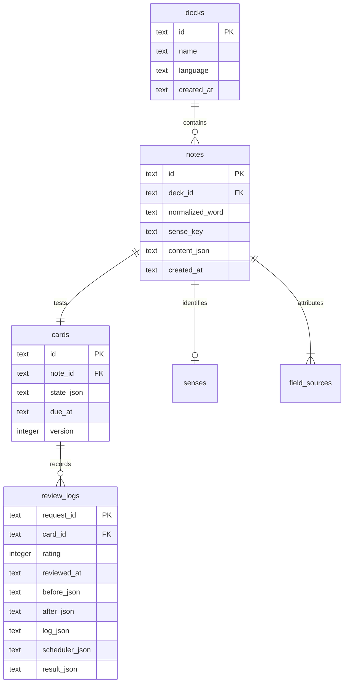

# 架構與設計決策

## 目前系統

一個 TypeScript package，前端／伺服器／共用契約依目錄分離。開發時 Vite 5173 將 `/api` 轉給 Fastify 3001；建置後由 Fastify 同源服務 `dist/web`。不需要 Docker、外部資料庫、訊息代理或帳號。

```text
browser
  React state + fetch + SpeechInput + system speech synthesis
             ↓ /api
  Fastify → Zod → Library / ContentProvider
                       ↓       ↓
                   ts-fsrs   Demo / DictionaryContentProvider → DictionaryProvider
                       ↓
                   SQLite
```

- `apps/server/src/app.ts` 可注入資料庫路徑、時鐘與 ContentProvider，供測試使用，不呼叫 `listen()`。
- `index.ts` 只處理環境與程序生命週期，綁定 loopback，關閉時釋放 SQLite。
- `Library` 保有資料交易與核心規則。P0 為縮小層次，參數化 SQL 直接位於服務；查詢複雜化時再抽 repository，避免先做空泛抽象。
- `scheduler.ts` 封裝 FSRS 與日期序列化，對前端不暴露套件實作。
- `packages/shared/src/contracts.ts` 為 HTTP 輸入的 Zod schema 與共用型別；目前前端回應採 TypeScript 型別，正式 provider 回應必須另外執行 runtime validation。
- `providers/content-provider.ts` 協調可編輯草稿；demo 與 DictionaryContentProvider 已實作。後者依 DictionaryProvider 介面串接 Free Dictionary API v2，fetch 可注入 fixture。其他例句／圖片／生成 provider 留在 P1.2。

## 為什麼這樣選

| 決策 | 原因與代價 |
| --- | --- |
| 全端 TypeScript | 共用型別與驗證、語音 API 直接在 browser 使用，接手 AI 只需維護一套語言 |
| React + Vite | 操作型介面不需 SSR，開發與靜態打包簡單 |
| Fastify | 有可直接注入的 HTTP 測試、輸入大小限制與清楚的插件邊界 |
| SQLite / node:sqlite | 單人本機、零外部服務、交易與索引；同步 API 適用此小型工作負載，重型工作不能阻塞主執行緒 |
| Node 24.x | 明確固定可使用 `node:sqlite` 的 runtime；此 API 的穩定度隨 Node 次版本演進，集中在一個 adapter，升級需重跑測試 |
| ts-fsrs | 採用現成排程與卡片狀態，不自行猜間隔；版本固定，升級需測試資料相容 |
| JSON 內容 + 結構化排程欄位 | P0 快速迭代教材，due 與 version 可索引／條件查詢；P1 拆出義項、欄位來源與媒體 |
| 原生 Web Speech 先行 | 能力偵測與文字備援成本低；支援度、隱私與離線不一致，不視為通用 STT 解法 |

本專案使用精確套件版本與 `pnpm-lock.yaml`，`pnpm-workspace.yaml` 明列只允許 esbuild 的安裝腳本。這是單一 package，檔案名稱不表示已拆成多 package monorepo。

## 現行資料表



P1.1 migration v2 已加入 `notes.sense_key`、`senses`（note_id、lemma、sense_key、part_of_speech、gloss、accent、pronunciations_json）與 `field_sources`（逐欄來源、作者、授權、取得時間、人工修改與欄位狀態）。`notes.normalized_word` 保存正規化 lemma，唯一鍵為 `(deck_id, normalized_word, sense_key)`；無正式義項的手動／demo／legacy 共用 `manual` 義項鍵。內容 JSON 是 API 快照，與結構化 metadata 於同一交易寫入。

`schema_migrations` 保存已套用版本。SQLite 啟用 foreign keys、WAL 與 busy_timeout；每個 migration 在交易內執行。P0 未提供刪除，外鍵未設 cascade，避免後續直接刪除卡片造成歷史靜默消失。

`content_json` 含 word、ipa、meaning、example、exampleTranslation、phrases、story、image、audio、source、sense、fieldSources。P1.1 的 image/audio 仍為 null，source 保留 P0 相容欄位；實際出處以 fieldSources 與 sense.pronunciations 的各筆來源為準。

`cards.state_json` 完整保存 FSRS card；`due_at` 是它的冗餘索引欄位，兩者必須同交易更新。日期統一 UTC `toISOString()`，固定格式使字串排序與時間排序一致。

## 狀態與不變條件

### 建卡

`word input → draft preview → explicit save → note + new card`

- 預覽不落盤，P0 刷新會遺失草稿；草稿保存是 P1 工作。
- 保存前 server 驗證詞與非空釋義，最多 64 KiB 的 JSON。
- 正規化為 NFKC、前後 trim、連續空白摺疊、英文小寫，同庫同義項唯一。
- note + new card 使用同一交易；新卡 due=serverNow，version=0。
- 首階段限制 en-US，其他語言在 API 直接拒絕，不能默默沿用英文正規化。

### 複習

1. 查 `due_at <= serverNow`，依到期與 id 穩定排序，每批上限 100。
2. 前端先顯示 word，使用者揭示才顯示答案與評分。
3. 送 `{ requestId, rating, version }`；時間由 server 產生。
4. 在 `BEGIN IMMEDIATE` 交易先查 requestId；同一內容則回原結果。
5. 若識別碼衝突、version 過時或尚未到期，拒絕，不計分。
6. FSRS 計算新狀態，同時更新 cards、寫 review_logs；失敗 rollback。
7. 前端重新取佇列。回應不明時保留原 requestId，讓重試可確認已保存的結果。

前端只套用最新一輪的單字庫／複習佇列回應，建立單字庫也會使較舊的列表請求失效；單字列表初始回應與本次已儲存的 note 依 id 合併。這些規則避免 StrictMode 或慢速回應覆蓋使用者剛完成的操作，並有元件回歸測試。

目前「揭示後才評分」是 UI 規則，API 未發放揭示 token；在單人可信任本機環境，使用者仍可直接呼叫 API。若未來需要嚴格會話順序，可加入 server session，不把當前 UI 條件視為防作弊機制。

## P1 遷移目標（P1.1 詞義與逐欄來源已實作）

| 資料 | 欄位／索引重點 |
| --- | --- |
| deck 設定 | nativeLanguage、accent、retention、newPerDay、reviewPerDay、timezone |
| notes / senses（P1.1 已完成） | lemma、senseKey、partOfSpeech、gloss、accent、pronunciations；唯一鍵 deck+lemma+senseKey；內容編輯與 updatedAt 留 P1.3 |
| field_sources（P1.1 已完成） | noteId、fieldPath、kind、provider、sourceUrl、author、license、licenseUrl、retrievedAt、model、promptVersion、userEdited |
| media_assets | id、relativePath、sha256、mime、size、kind、來源與授權；hash 去重 |
| note_media | noteId、assetId、用途與排序 |
| drafts / generation_jobs | 草稿內容、逐欄狀態、cacheKey、attempt、leaseUntil、errorCode、取消狀態 |
| review events | 撤銷事件與被撤銷紀錄 id；維持不可變歷史與最後事件限制 |

v2 遷移前以 `VACUUM INTO` 產生 `<DATABASE_PATH>.pre-v2-<uuid>.sqlite` 一致性備份（僅既有磁碟 DB）；新資料庫與記憶體 DB 不建立備份。v1 SQL 保持原樣，v2 在交易內重建 notes 唯一鍵，暫停外鍵檢查後於提交前執行 foreign_key_check，成功才重新啟用 foreign_keys。遷移失敗回滾、停止啟動，不跳過損壞資料。舊 content_json 原有內容與 `source.kind=demo` 原樣保留，新增逐欄來源標為 legacy，不改成 retrieved。既有卡片、版本與 logs 不重設。P2 多卡型時移除 `cards.note_id` unique，改為 `(note_id, template)`，保持各卡獨立狀態。

## 本機資料與外部邊界

- 只綁 `127.0.0.1`；檢查 Host 與已知本機 Origin，無通用 CORS。無 Origin 的本機 CLI 允許。
- 這不是本機惡意程式的安全隔離；未加入 authentication，符合單人使用範圍。
- React 以文字渲染內容，不使用 `dangerouslySetInnerHTML`；正式來源也不能注入任意 HTML。
- `.env`、資料庫、錄音與媒體不能入 Git；provider keys 不能出現在前端。
- P0 沒有錄音檔上傳，瀏覽器自己決定辨識路徑；啟用前提示可能外傳。SpeechRecognition 支援度與服務行為見 [MDN](https://developer.mozilla.org/en-US/docs/Web/API/SpeechRecognition)。
- Web Speech API 的聲音由系統提供，不等於真人錄音；localService 屬性可識別本機或遠端語音服務，見 [SpeechSynthesisVoice](https://developer.mozilla.org/en-US/docs/Web/API/SpeechSynthesisVoice)。
- 正式下載／生成 provider 需時間與大小限制、特定網域、逐跳重導向驗證、資料來源與授權記錄，細節見 PLAN。

## 擴充時的建議順序

P1.1 已以固定 fixture 與真實字典完成多義流程，預設在輸入後即時查詢，不預載完整資料集；下一步依 P1.2 處理工作生命週期、媒體與其他來源。媒體下載與生成工作皆經 server；昂貴任務改背景 worker／子程序。單人規模尚不需要抽多服務，也不需要引入 Redis、PostgreSQL 或 Kubernetes。
